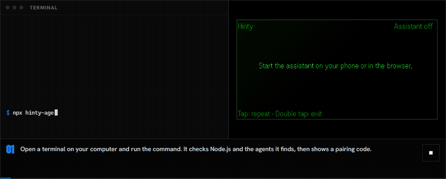

# hinty-agents

[](https://www.npmjs.com/package/hinty-agents) [](LICENSE)



Approve or deny your AI coding agent's permission prompts, and follow what each session is doing, from Hinty
smart-glasses or the Hinty web panel while you are away from the desk. Claude Code, Codex CLI, Grok Build, OpenClaw and Hermes Agent.

```
api       asks to run: npm run test:e2e        [Allow once] [Deny]
web       done: fixed the signup form, 3 files
```

It is a small Node.js service that runs on your computer, plus a Claude Code plugin (two hooks and a mod). The code
is open because it approves commands on your machine: read it before you run it.

More: [hinty.eu/assistant/agents](https://www.hinty.eu/assistant/agents) · privacy: [hinty.eu/privacy#agents](https://www.hinty.eu/privacy#agents) · vulnerabilities: [SECURITY.md](SECURITY.md) · [CHANGELOG.md](CHANGELOG.md)

## How it works

```
Claude Code ──PermissionRequest / SessionStart hooks──┐
            ──mod (session status, instructions)──────┤ 127.0.0.1, random port, signed requests
                                                      ▼
                                  hinty-agents service (one per computer)
                                                      │ Socket.IO, bridge token
                                                      ▼
                         Hinty relay (api.v1.hinty.eu/agents-link, memory only)
                                                      │
                                     glasses (Even G2, hinty.eu/g) / web panel
```

- **PermissionRequest hook** (`claude-plugin/hook.cjs`): when Claude Code would ask you for permission, the hook
  asks the service. The service sends a card (session label, tool, command text) and waits. Your answer from the
  glasses or the panel comes back as *allow once* or *deny*. The terminal prompt stays open at the same time;
  whichever answer comes first wins.
- **SessionStart hook**: registers the session (label = folder name, `-2`, `-3`... for repeats) and, while this
  computer is paired, asks the agent to end each answer with one short line starting with 👓 (what it did or what
  it asks you). That line is what the glasses show.
- **Mod** (`claude-plugin/hooks/register.mjs`, runs inside Claude Code without starting processes): while away mode
  is on it reports the session's state (running, asking, done, the 👓 line) and delivers instructions you send from
  the glasses as a normal user message (`$.prompt.submit({ text, asUser: true })`), also to an idle session. It
  identifies its session with `$.session.id()`, the same id the hooks receive as `session_id`.

## Security

### Who can do what

The parts that can act on your computer are the agent (your own Claude Code, Codex... session), this service, and
whoever sends it events through the Hinty relay. The relay is the Hinty server; anyone who controls your Hinty account
(password, session) can use it too. Plan for that:

| | The relay / your Hinty account can | It can never |
|---|---|---|
| Away mode OFF | see that this computer is paired and online (`hello`: host name, which agents are installed, voice yes/no), switch away mode **on only if you allowed it** (below) | see sessions, prompts or answers; send instructions; approve anything |
| Away mode ON | see session names, status lines, permission cards and the last answers; **send instructions** that reach an open agent session as your message; **allow once or deny** a waiting permission request whose card shows everything that will run; switch away mode off | answer anything but *allow once* / *deny* through this bridge (no "always", no changed command, no wider rules), allow a request whose card the bridge marked incomplete, act without an open agent session, read files on its own, keep away mode on later than 12 hours after you last switched it on (or allowed remote switch-on) at this computer |

So while away mode is on, the relay and your Hinty account are trusted like a person at your keyboard who can type
into an open session and press *allow once*. That is the point of the feature; keep it on only while you are away,
and protect your Hinty account. End-to-end encryption between this computer and your screen is planned.
"A replayed or forged decision is ignored" below protects you against third parties, not against the relay itself.

The "It can never" column is what this bridge enforces. Two things it cannot fully control are spelled out below: an
instruction is text that an open session acts on (an agent told to change its own settings may do so, as it would
if you typed it), and each agent decides how it treats that text (the bridge sends it in a way that none of the
supported agents runs as a command; see "Instructions are plain text").

### Rules in the code

| Rule | What the code does |
|---|---|
| No answer means no decision | Service down, away mode off, link lost, refused by the relay, time up (840 s, before the hook's 900 s limit), another protocol version, any error: the hook prints nothing and exits 0, so the agent asks in the terminal as usual. It never approves on its own. |
| Allow once or deny, nothing else | The hook can print exactly two fixed JSON answers. It never sends `updatedInput` or `updatedPermissions`, so a remote answer can neither change the command nor widen your permission rules. The agent's own `deny` rules still win. |
| A decision must match | Accepted only while away mode is on, for a request id (128 random bits, single use) this service created, still waiting, not expired, and with the SHA-256 hash of exactly what was asked (`rid`, session, sub-agent, tool, tool input). A replayed or forged decision from anyone else is ignored. |
| Incomplete cards can only be denied | When the card does not show everything that will run (something was cut, a secret was masked or a value was left visible on purpose, invisible or control characters were removed (decided by Unicode property, not a list: every default-ignorable, format, private-use and unassigned character, so also soft hyphens, variation selectors and tag characters; an emoji with a variation selector or joiner keeps it but makes the card incomplete), blank padding was folded: lines with nothing visible on them (any white space, combining marks, Braille, Hangul and other blank symbols), runs of more than 20 spaces or 8 tabs; a field has a shape the bridge does not know; the agent itself redacted the command (Hermes); environment overrides whose values the agent does not send (OpenClaw)), it is sent with `part: true`. The glasses and the panel offer only *Deny*, and **this service itself refuses a remote *allow*** for it, whatever the relay says. Approve such a request in the terminal. Every cut on a card is marked (`[… cut: 7,000 of 48,211 characters shown]`). |
| Away mode is opt-in | Off by default and after every restart. While off, nothing about your sessions leaves the computer and the hook answers at once. It turns itself off 12 hours after it was switched on. |
| Remote switch-on needs your consent | The Hinty panel or the glasses can switch away mode **on** only if you allowed it on this computer (the setup wizard asks once; `npx hinty-agents remote-away on\|off`; default **off**). Without it a remote switch-on is refused and logged. A remote switch-on lasts at most until **12 hours after you last switched away mode on here or gave that consent**: switching it off and on again remotely does not start the 12 hours again, and after them a remote switch-on is refused until you run `away on` or `remote-away on` at this computer. It is always visible here: Claude Code's status line and a toast, a system notification, `npx hinty-agents status`, the log. Switching it **off** remotely always works. |
| Pairing needs a number from your panel | After the pairing code is typed in the panel, that panel shows a 4-digit number and the terminal asks you to type it (3 tries). Only the account that typed the code sees the number, so a code read off a shared screen and typed into someone else's account does not get past this step: a wrong number, no number or no terminal (piped input) disconnects the computer again and nothing is saved. The terminal also shows the masked account (extra information only). |
| Secrets are masked | Before any text leaves: `sk-…`, `ghp_…`, `AKIA…`, `Bearer …`, `password=…`, JWTs, private keys, credentials in URLs and similar are replaced with `***` (and the card becomes incomplete). A value that contains shell syntax (`$(`, backticks, `;`, `|`, `&`, `<`, `>`) is never hidden: it may be the part that runs. Best effort, not a guarantee. Every pattern runs in linear time (1 MB of crafted text per pattern in well under 100 ms). |
| Instructions are plain text | Every instruction is cleaned (no control or invisible characters) and every line that starts with `/ ! # @ $` gets a zero-width space in front, so Claude Code and Codex never read it as a slash command, bash mode or a memory note. OpenClaw cleans a message itself before it looks for commands, so for OpenClaw an instruction additionally goes over a **separate Gateway connection that has no approval rights** (OpenClaw refuses `/approve` from it), starts with a fixed line OpenClaw's clean-up cannot remove, and has `/` and `!` neutralised after `]`, `:` and white space too; every message is checked with a copy of OpenClaw's clean-up before it is sent. Details below. |
| Local port | Listens on `127.0.0.1` only, random port. The key in `~/.hinty-agents/daemon.json` (readable by you only) **never travels**: every request from a hook, the mod, the CLI or the Hermes plugin is signed with it (HMAC-SHA256 over a one-time nonce, a timestamp, method, path and the body's SHA-256; 30 s window, a nonce counts once), and every answer is signed over the request's nonce, the status and the body. Before a hook, the mod or the Hermes plugin sends anything with content (a command, a prompt, an answer, a session id) it checks that the process in `daemon.json` is alive and that the port answers a signed ping with that process's id (limit 0.3-1.5 s). So a process that grabbed the port of a crashed service gets no content, cannot answer for the service and cannot make a hook wait. A stale `daemon.json` is removed when the service starts. Requests with an `Origin`, `Sec-Fetch-*` or foreign `Host` header (browsers) are refused. Protocol version 2 (`pv` in `daemon.json`): hooks, mod and service of different versions stay silent (no answer = the agent asks as usual); `doctor` tells you what to update. |
| No programs from the current folder | On Windows, programs (`claude`, `npm`, `codex`, `openclaw`, `hermes`, `icacls`, `taskkill`, `whoami`) are found by the bridge's own `PATH` lookup or by full path (never the current folder) and started without a shell, with `NoDefaultCurrentDirectoryInExePath=1`. The Codex and Grok hooks start Node.js **by its full path** (Codex runs hook commands with `cmd.exe` in the session's folder, which would otherwise run a `node.cmd` from a cloned repository); after you move or remove that Node.js, `doctor` says so and `install codex|grok` writes the new path. `install` and `doctor` also run the installed command (with `--ping`: nothing is read or sent) in `cmd.exe`, PowerShell and `sh` and say where it does not start, so a hook that silently never runs (for Grok with `--ask-shell`: no veto) shows up. `HINTY_AGENTS_HOME` counts only as an absolute path, and the hooks start the service only from an installed hinty-agents outside the session's project folder. |
| `stop` and the lock check the service | `stop` kills a process only after it answered a signed ping with the pid in `daemon.json`; a lock file held by a process that never answers is taken over after 3 seconds. |
| Data folder for you only | `~/.hinty-agents` (or `HINTY_AGENTS_HOME`) is narrowed at every start of the CLI and the service, not only when it is created: 0700 on Linux and macOS (`doctor` warns when another user owns it); on Windows the access list is set to your account (by SID) and SYSTEM and read back, and `doctor` warns when anybody else can still open it. A `HINTY_AGENTS_HOME` that is your home folder, a drive or a system folder (or holds one) is left as it is and `doctor` says so: give hinty-agents a folder of its own. |
| The relay keeps no content | The Hinty server holds cards and session status in memory only (minutes); the database stores only a hash of this computer's token. Content crosses the server in transit (TLS). |

Logs (`~/.hinty-agents/daemon.log`) hold identifiers and counts only, never commands or answers, one event per line.
The Claude Code mod writes an instruction's id and length (not its text) to Claude Code's own debug log.

### Known limits (read before you rely on it)

- **The relay is trusted while away mode is on** (table above). Masking secrets is best effort; content crosses the Hinty
  server in transit.
- **The manifest of the program copy checks consistency, it is not a firewall.** It catches a copy that is incomplete,
  old or changed later (the full check runs in `start`, `install` and `doctor`); it does not stop somebody who can
  write to the data folder before its first use, and the service started from a hook is checked by code from the same
  copy. With your own `HINTY_AGENTS_HOME` in a shared folder (one other accounts can reach) the protection depends on
  the folder's permissions. The recommended place is the default `~/.hinty-agents`.
- **`HINTY_AGENTS_HOME` from the environment is trusted** when it is an absolute path without a part that ends in a
  space, a tab or a dot (Windows tools read such a name as another folder; the value is then ignored with a warning). Whoever sets it in your agent's
  environment (a `direnv` file, an editor workspace setting) chooses the data folder the hooks use, including the
  service they start. Do not let a project set it.
- **The Claude Code plugin starts `node` by name** (its `hooks.json` cannot hold a per-computer path). Claude Code runs a
  project's hooks only after you trust the folder, and a trusted project can run its own hooks anyway, so this adds no
  new way in; the Codex and Grok hooks use the full path.
- **OpenClaw**: the bridge talks to the Gateway over plain `ws://127.0.0.1`, and the Gateway protocol does not prove the
  server's identity. While the Gateway is down, a process that takes its port receives the device token of the
  connection that is opening (not usable without that device's key) and can show made-up cards. `install openclaw --url`
  is not checked: use only a local Gateway. A plugin approval card shows only what the plugin wrote (title,
  description); environment overrides of an exec request are listed by name, their values never reach the bridge.
- **Hermes**: the plugin sees only Hermes's display copy of a command, after Hermes hid secrets in it; such a card is
  incomplete, so a prompt that carries a secret (and `git diff a...b`, `go test ./...`: anything with `***` or `...`) is
  approved at the computer. Messages from the glasses go into one queue for every Hermes process with the plugin; when
  the bridge does not know a session's key, Hermes picks the conversation itself.
- **Codex `codex queue --message`**: an instruction is handed to Codex as a command-line argument, which on a shared
  Linux or macOS computer other users can see in the process list for a moment. `"codex": {"queue": false}` in
  `~/.hinty-agents/config.json` sends instructions through the held `Stop` hook instead.
- **Pin the version you install**: `npx hinty-agents@<version>`; a plain `npx hinty-agents` may fetch a newer release,
  and the hooks start the service from the copy you installed.

## Desktop app (Windows, macOS)

For people who do not use a terminal: **Hinty Agents** is an installer with a small window and an icon next to the
clock. Node.js comes inside it, nothing else needs to be installed (only the agents themselves and a Hinty account).

- **Windows:** `Hinty-Agents-Setup-<version>.exe`, one click, for your user only (no administrator rights). Not signed
  yet: Windows SmartScreen says "unknown publisher" (More info -> Run anyway).
- **macOS:** `Hinty-Agents-<version>-arm64.dmg` (Apple silicon) or `-x64.dmg` (Intel), signed with a Developer ID and
  notarized by Apple. Built from the release tag in a private build repository (it holds the signing certificate and
  the App Store Connect key, which never come into this public one); `.github/workflows/desktop-mac.yml` here only
  checks that the app still builds, unsigned.

The window does what the wizard does, with buttons: it shows the pairing code (type it at hinty.eu, Voice Assistant ->
Agents) and then asks for the 4-digit number the panel shows; it switches away mode on and off; it has the remote
switch-on consent as its own checkbox (off by default, with the risk written next to it); it finds Claude Code, Codex,
Grok Build, OpenClaw and Hermes and connects or disconnects each one (the same `install` / `uninstall` as below, with the
Codex trust note and the Grok `--ask-shell` warning); it installs the voice with a progress bar; "Remove everything" is
`uninstall --all` (with `--purge` if you tick "also delete my data"). It starts with your session in the background
(next to the clock, no window; a checkbox turns that off) and keeps the service running while this computer is paired.
Ten languages, the system's by default.

Under the window it is this same package, unchanged: the app starts `bin/hinty-agents.js desktop` on its own Node.js and
every button is one of the commands below (`src/desktop.js`), so the security model above holds as it is. Two things
differ because the Node.js is the bundled one:

- the program copy `~/.hinty-agents/app/<version>` names that Node.js by its full path in the Claude Code plugin's
  `hooks.json` (a person without Node.js has no `node` on PATH); the Codex and Grok hooks name it too, as always.
  Installed from `npx` with Node.js on PATH, `hooks.json` keeps `node`. `doctor` checks that the named Node.js exists;
- the Electron binary itself never runs code of the bridge: its `RunAsNode`, `NODE_OPTIONS` and `--inspect` fuses are
  off, the window has no Node.js access (sandbox, context isolation, a fixed list of calls checked twice) and loads
  nothing from the network.

The bundled Node.js is the official LTS build from nodejs.org, the same version on both systems, its sha256 pinned in
`desktop/scripts/node-runtime.mjs`. Uninstalling the app (Windows Settings -> Apps) first runs
`hinty-agents uninstall --all --purge`; an update stops the service and lets the new version start it. Building the
app: [desktop/README.md](desktop/README.md).

## Install

Requirements: Node.js 20+, Claude Code (`claude`) with mods enabled (default since 2.1.287), a Hinty account. (No
Node.js? Use the [desktop app](#desktop-app-windows-macos).)

Run it with `npx`. **Pin the version** (the hooks run on your machine, so you decide when to update):

```bash
npx hinty-agents@0.4.0
```

Or straight from GitHub (a tag, not a branch):

```bash
npx github:hinty-eu/hinty-agents#v0.4.0
```

**Where it lives.** `npx` runs from npm's cache, which npm may clean at any time. So setup (and `start`, `install`)
first copies the program, with its one dependency `socket.io-client`, to `~/.hinty-agents/app/<version>/`
(`HINTY_AGENTS_HOME/app/<version>/` if you set it) and uses only that copy: the service, the Codex / Grok / Hermes hook
files and the Claude Code plugin marketplace point there. Reading the code you run: `~/.hinty-agents/app/<version>/src`.
When the copy is made, the size and SHA-256 of every file go to `app/.manifests/<version>.json`; a folder of that
version is used only while it matches (`start`, `install` and `doctor` check every file, the service at start checks
files and sizes). A copy that does not match is copied again from the package, and the service refuses to start from it.
Running another version copies it next to the old one; the previous version is kept, older ones are removed. A git
checkout (a `.git` folder, or `HINTY_AGENTS_DEV=1`) runs in place, without a copy.

The wizard checks Node and Claude Code, shows a pairing code (type it in the Hinty panel: Voice Assistant → Agents),
then asks for the 4-digit number the panel shows after the code (run it in a terminal: piped input is refused), stores
the token in `~/.hinty-agents/config.json`, installs the Claude Code plugin with Claude Code's own commands, and starts
the service. The plugin step is the same as running:

```bash
claude plugin marketplace add ~/.hinty-agents/app/<version> --scope user
claude plugin install hinty-agents@hinty-agents --scope user
```

New Claude Code sessions load it (open ones: `/reload-plugins` or restart). Installing a newer version updates the
marketplace and the plugin too; `doctor` tells you when the plugin and the service are different versions. Then, when you leave the desk:

```bash
npx hinty-agents away on      # or in the panel, if you allowed remote switch-on
npx hinty-agents away off     # back at the desk (the panel and the glasses can always switch it off)
```

## Commands

| Command | |
|---|---|
| `npx hinty-agents` | set up (options: `--no-install`, `--no-start`, `--label <name>`) |
| `uninstall --all` | remove everything (see Uninstall) |
| `status` | service, link, away mode, sessions |
| `away on\|off` | away-from-desk mode |
| `remote-away on\|off` | allow (or not) the Hinty panel / glasses to switch away mode ON (default off; off always works) |
| `install <claude\|codex\|grok\|openclaw\|hermes>` / `uninstall <...>` | add or remove an agent's integration (`install grok --ask-shell`: see Grok Build; `install openclaw --token-file <file>`: see OpenClaw) |
| `doctor` | checks Node, Claude Code, the plugin (`claude plugin validate`), the service, the link, the hook and whether the mod reports in |
| `unpair` | disconnect this computer from your account and delete the token |
| `voice install` / `status` / `remove` | local speech to text for dictation from the glasses (see Voice) |
| `start` / `stop` | start or stop the background service (`stop` also keeps it from starting with the next session) |

After a reboot the SessionStart hook starts the service again (unless you ran `stop`).

Environment: `HINTY_AGENTS_API` (server for a new pairing, default `https://api.v1.hinty.eu`; another server is
announced with a warning, plain `http` only to this computer), `HINTY_AGENTS_HOME` (data folder, default
`~/.hinty-agents`; an absolute path, a relative one is ignored).

## Codex CLI

```bash
npx hinty-agents install codex      # merges 6 hooks into $CODEX_HOME/hooks.json (default ~/.codex)
npx hinty-agents uninstall codex    # removes exactly those entries
```

Needs Codex CLI 0.171 or newer for instructions (`codex queue`); permission cards and status work with any version that
has hooks. Your own `hooks.json` entries and `config.toml` are never touched: install adds our entries, keeps a copy of
your file once (`hooks.json.hinty-agents.bak`), and uninstall removes only ours. If `config.toml` also declares `[hooks]`
or switches hooks off, install says so.

**Trust (once).** Codex runs a new hook only after you trust it. At its next start Codex shows *Hooks need review*:
choose *Trust all and continue* (or review them later with `/hooks`). Until then nothing of Hinty runs in Codex.

The hooks start Node.js by its full path, written with forward slashes (on Windows its short `C:/PROGRA~1/...` form when
the path has spaces; that form starts in `cmd.exe`, PowerShell and `sh` alike). On a drive without short names a path
with spaces works in `cmd.exe` only: install says so. After a
Node.js update that moves it, or with a version manager that removes the old version, `doctor` reports it; run
`npx hinty-agents install codex` again (Codex then asks you to trust the changed hooks once more). A Codex install
from 0.2.x still starts `node` by name: `doctor` flags it, `install codex` fixes it.

| | |
|---|---|
| Permission cards | `PermissionRequest` hook: allow once or deny from the glasses or the panel. Same rules as Claude Code (N1-N3, N8, N11). |
| Session state | `SessionStart`, `UserPromptSubmit`, `PostToolUse`, `Stop`, `SessionEnd`: the session appears next to your Claude Code ones (`agent: codex`), with the 👓 line from the final answer. |
| Instructions | `codex queue --thread <session> --message <text>`: Codex shows it as your next message, also in an idle session at the prompt. No shell is involved (the text is one argument; on a shared Linux or macOS computer other users can see it in the process list for a moment, `"codex": {"queue": false}` in `config.json` turns this road off). Fallback (and with that switch): the `Stop` hook is held (up to 9 minutes, 8 instructions in a row) and answers `{"decision":"block","reason":<text>}`; Codex then continues with it. |

Limits worth knowing:
- **While a card waits, Codex shows no prompt in the terminal.** Codex asks you only after the hook has answered (checked
  live on 0.171), unlike Claude Code, which shows both at once. If you are back at the desk, `npx hinty-agents away off`
  (or switch it off in the panel) releases the waiting hook at once and the terminal asks as usual (measured: ~0.4 s).
  Unanswered cards expire after 570 s with the same result.
- Away mode off, service down or link lost: the hooks print nothing and finish in ~0.1 s (median 127 ms on Windows).
- With the held-`Stop` fallback the Codex input bar shows "Running hooks" while the hook waits.
- An instruction that is a Codex slash command is not run as one: every instruction is sent as plain text (see Instructions
  are plain text below).

## Grok Build

```bash
npx hinty-agents install grok                # session status only
npx hinty-agents install grok --ask-shell    # plus a card for every risky shell command
npx hinty-agents uninstall grok
```

Writes `~/.grok/hooks/hinty.json` (an existing file of that name that is not ours is backed up and restored by
uninstall). Not tested on a live Grok Build (it needs a paid xAI account); the hook scripts and the whole bridge are tested
with Grok's documented hook input and output (docs.x.ai/build/features/hooks).

**Read this before `--ask-shell`: Grok hooks fail open.** Grok can block a step only from `PreToolUse`, and when the hook
crashes, times out or the service is down, Grok **runs the step**. So with `--ask-shell`:
- a card appears for each shell command that is not on the harmless list (`ls`, `pwd`, `cat`, `git status|diff|log`, ...).
  Only ONE plain command is ever harmless: any chaining (`&`, `;`, `|`), redirection, `$`, backticks, quotes, options that
  write or run something (`--output=`, `-o`, `--ext-diff`...) and `cat`/`head`/`tail` paths outside the project (absolute,
  `..`, `~`) always get a card. `npm test` is not on the list (it runs a script the agent can edit). Own list:
  `"grok": {"except": [...]}` in `~/.hinty-agents/config.json`;
- **Deny** vetoes the step. **Allow** only means "no veto": Grok's own permission prompt still applies;
- if nobody answers within 280 s, the service is down, away mode is off or anything fails, the step runs (as Grok does with
  any failing hook). Do not use this as a security boundary; Grok's own `deny` rules and sandbox are the guarantee.

Without `--ask-shell` only the passive hooks are installed. Grok ignores the output of those, so there is no glasses line
and **instructions from the glasses are not supported** for Grok sessions.

## OpenClaw

`npx hinty-agents install openclaw` pairs the bridge once with your **local** OpenClaw Gateway as **two devices** (the
first connection from the loopback pairs itself; a remote Gateway needs `openclaw devices approve <requestId>`):

- *approvals* (`operator.read`, `operator.approvals`): receives approval prompts and session events, answers prompts,
  and never sends chat text;
- *instructions* (`operator.read`, `operator.write`, **no** `operator.approvals`): sends your messages with `chat.send`.
  OpenClaw refuses `/approve` (and other approval commands) from a client without `operator.approvals`, however the
  text is dressed up, so a message can never approve anything. If your Gateway gives this device approval rights too,
  install says so and keeps instructions off. If the second pairing fails (a Gateway that has just started may not
  answer it for some seconds; install tries three times), the approvals device is kept and instructions stay off until
  you run install again. A device the Gateway paired but the bridge cannot use is named with the
  `openclaw devices remove <id>` to run, in install, `doctor` and uninstall.

It reads the Gateway port and token from your `openclaw.json` (or `OPENCLAW_GATEWAY_TOKEN`) for these two connections
only and does not store the shared token; if the token is a secret reference (`file` / `exec`) give it once with
`--token-file <file>`. **Nothing in your OpenClaw configuration is changed.** Works with OpenClaw 2026.3.x (protocol 3)
and is written for 2026.11 (protocol 4, negotiated; not yet tried on a live 2026.11). **Paired with 0.2.x?** That
pairing used one token with every scope and is no longer used: run `npx hinty-agents install openclaw` again and remove
the old device with the `openclaw devices remove <id>` it prints.

- **Approvals.** Every exec (and plugin) approval request becomes a card on the glasses / panel; **Allow** sends
  `allow-once`, **Deny** sends `deny`. `allow-always` is never sent. No answer sends nothing: OpenClaw then applies its own
  `askFallback` (default: deny) or another window of yours answers. An answer from another window (Control UI, TUI,
  `/approve`) closes the card at once. The card shows the command and every field that changes what runs (argv when it
  differs, the preview, the resolved program path, cwd, host, the exec policy); environment overrides are listed by
  name (OpenClaw does not send their values), which makes the card incomplete (*Deny* only), as does a run plan or a
  field the bridge does not know.
- **The bridge is an OpenClaw client only while away mode is on** (and the link to Hinty is up). The mere presence of an
  approvals client changes OpenClaw's behaviour (a request waits until it times out instead of ending at once), so at the
  desk the bridge is not connected at all.
- **Sessions and messages.** Up to 8 recently active sessions show on the glasses (label = the agent, plus the channel for
  non-web sessions, e.g. `publisher·telegram`), with the `👓` line of the last answer. A message from the glasses is sent
  with `chat.send` over the instructions connection as plain text (see "Instructions are plain text").
- **Tokens.** The two device tokens are stored in `~/.hinty-agents/openclaw/` (owner only). The instructions token can
  message your sessions: neither goes to the Hinty server or to a log. Revoke them with `openclaw devices remove <id>`
  (`uninstall openclaw` prints both commands and deletes the local files).
- **Warning: `askFallback: full`.** If your OpenClaw is set to `askFallback: full`, OpenClaw itself allows a step when
  nobody answers in time, and the bridge cannot change that. `doctor` and `install` warn when they see it in
  `exec-approvals.json`; set it to `deny` to keep "no answer = no".

## Hermes Agent

`npx hinty-agents install hermes` (needs Hermes 0.21.5 or newer) copies a small plugin (Python, standard library only,
`hermes-plugin/hinty-agents`) into `<HERMES_HOME>/plugins/hinty-agents` and sets, with `hermes config set`:

```
security.approval.transport_fallback = builtin        (set first)
security.approval.transport          = hinty
plugins.entries.hinty-agents.allow_gateway_injection = true
```

and enables the plugin. It remembers what you had; **`uninstall hermes` puts the earlier values back** (or Hermes's
defaults) and never leaves `transport: hinty` with `fallback: deny` behind. Restart the Hermes gateway / open sessions
afterwards (plugins load once per process).

- **Approvals.** While away mode is on, each approval prompt (CLI, TUI, Desktop, messengers) is shown on the glasses /
  panel through Hermes's approval transport; Allow = `once`, Deny = `deny`. `session` and `always` are never returned.
  The plugin receives Hermes's display copy of the command, in which Hermes has already hidden secrets (`KEY=***`,
  `abc...xyz`, `«redacted…»`, `[REDACTED …]`, folded padding `⟨+N …⟩`, and, for other Hermes versions, anything that
  looks like a marker: `<redacted>`, `[hidden]`, `•••`, `███`, written-out `\u200b`); a card with any such trace is incomplete, so
  **prompts that carry a secret are approved at the computer** (also `git diff a...b` or `go test ./...`).
- **No answer = Hermes asks as usual (N1).** Away mode off, the bridge not running, no answer in time or any error makes
  the plugin raise, and `transport_fallback: builtin` makes Hermes show its normal prompt. **Trade-off:** while away mode
  is on, the terminal prompt appears only after that wait (about 7 seconds before Hermes's own approval timeout, 5 minutes
  by default), so switch away mode off when you sit down. `doctor` checks that the fallback is `builtin`.
- **Sessions and messages.** Session state and the last answer come from Hermes hooks; a message from the glasses reaches
  the session through `ctx.inject_message` as a plain user message (a leading `/` or `!` is neutralised, and the plugin
  refuses anything that still looks like a command). Messages need the plugin's polling thread, so they work while
  Hermes runs. The plugin cannot always tell which of several simultaneous sessions asked: with exactly one running
  session it is exact, otherwise the card is labelled by Hermes's session key.
- **Needs Python 3.14 as Hermes's own interpreter** (Hermes builds an isolated 3.14 environment for plugins); the plugin itself
  is plain standard-library Python.
- Verified: install / uninstall with the real `hermes` CLI (settings restored), the real plugin loader registering the
  `hinty` transport, a live Hermes session calling the transport and falling back to its normal prompt when the bridge says
  no (away mode off), and the allow / deny / failure handling through Hermes's own `invoke_approval_transport`. Not verified
  on a live session: an answer from the glasses in a running TUI, and `ctx.inject_message`.

## Instructions are plain text

Whatever you send from the glasses or the panel reaches the agent as an ordinary message, never as a command: Claude Code
treats a leading `!` as bash mode (no permission), `/` as a slash command and `#` as a memory note, and OpenClaw runs a
chat line `/approve <id> allow-always` as an approval (checked on a live OpenClaw). The service puts a zero-width space
in front of every line that, after leading white space, starts with `/`, `!`, `#`, `@` or `$`. Other text is passed
byte for byte.

OpenClaw needs more, because before it looks for a command it cleans the message itself: it removes every `[...]`, a
`label:` at the start of a line and turns a written-out `\n` into a space, so `[x]/approve …` or `note:/approve …` became
`/approve …` there. For OpenClaw an instruction therefore (1) goes over the instructions connection, which has no
`operator.approvals` (OpenClaw answers *"/approve requires operator.approvals"*), (2) starts with the fixed line
`Message from the user, sent from Hinty (glasses or web panel):`, which that clean-up cannot remove, so the message never
starts with `/` or `!`, and (3) has a zero-width space before every `/` or `!` that follows white space, `]`, `:` or a
written-out `\n` (not inside `://`), and OpenClaw's "current message" marker broken up. `test/openclaw-strip.test.js`
runs a copy of OpenClaw 2026.3.28's clean-up over these cases.

## Voice (dictate to your agents from the glasses)

Local speech to text, free, no cloud API. Say an instruction in the glasses' dictation view; the text comes back to the
glasses, you choose Send / Edit / Add / Cancel, and only Send reaches the agent.

```bash
npx hinty-agents voice install      # engine + default model (downloads ~0.64 GB)
npx hinty-agents voice status
npx hinty-agents voice remove       # deletes the engine and every model
```

- **Engine:** `sherpa-onnx-node` 2.0.2 (Apache 2.0), installed on demand into `~/.hinty-agents/voice/`, never added to this
  package's dependencies. The exact package tree comes from a lock file shipped here (`src/stt/voice-package-lock.json`:
  `sherpa-onnx-node` and its per-platform packages, each with a sha512 `integrity`) and is installed with
  `npm ci --ignore-scripts`: no version is chosen at install time and no package script runs (2.0.2 ships prebuilt
  binaries and needs none; checked on Windows x64). Models go to `~/.hinty-agents/models/<id>/`; each file is checked
  against a pinned size and SHA-256 and written atomically. A running service says `hello` again with `stt: true` right
  after the install.
- **Models:** `parakeet-v3` (default; NVIDIA Parakeet TDT 0.6b v3 int8, 25 European languages incl. Polish, CC BY 4.0, ~640 MB,
  ~1 GB RAM while in use), `whisper-small` (358 MB) and `whisper-turbo` (989 MB, too slow on CPU for dictation) with
  `voice install --model <id>`. Silero VAD (0.6 MB) splits speech into stretches that are recognized while you are still
  talking. The model loads when dictation starts and is released after 10 idle minutes.
- **Developer words:** the default model is biased towards ~130 words like commit, rebase, README, endpoint, package.json
  (`src/stt/hotwords.txt`). Add your own, one per line (`word :2.5` sets a score), in `~/.hinty-agents/hotwords.txt`.
  `HINTY_AGENTS_HOTWORDS=off` turns the bias off.
- **Privacy:** audio exists only in memory while one utterance is recognized (at most 35 s, one at a time) and is dropped
  afterwards; nothing is written to disk and logs hold counts only. Recognition runs on this computer. With away mode off
  the bridge reads nothing: it only answers `away_off`. Only the recognized text goes back to your own glasses screen.
- **Accuracy:** measured in `testy-e2e/agenci/stt/WYNIKI.md` of the Hinty repository. English commands are near perfect; Polish
  sentences with English jargon often need a fix in the preview step.

## Uninstall

Everything in one go:

```bash
npx hinty-agents uninstall --all
```

It removes the hooks and plugins of every agent you installed (Claude Code plugin and marketplace, Codex, Grok, OpenClaw,
Hermes), unpairs this computer (revokes the token), stops the service, deletes `~/.hinty-agents/app/` and asks whether
to delete the rest of `~/.hinty-agents` too (`--purge` deletes it without asking, `--keep-data` keeps it). Only what
hinty-agents created is deleted: the folder itself goes only when it carries the `.hinty-agents-home` marker (written
only when hinty-agents creates the folder or finds it empty; it lists the entries hinty-agents made) and nothing else is
left in it. A `HINTY_AGENTS_HOME` that points to a folder which already holds other things gets no marker (a warning says
so), and `--purge` removes from it only the files hinty-agents made (the checksum-verified voice model files, its hook
scripts, its settings and logs), never a `models`, `app` or `hooks` folder as a whole. A `HINTY_AGENTS_HOME` that is
your home folder, a drive or a system folder is never emptied. Point `HINTY_AGENTS_HOME` at an empty or new folder, or
leave it unset. `npx` keeps
its own cache; `npm cache clean --force` empties it.

One at a time:

```bash
npx hinty-agents uninstall claude   # removes the plugin and the marketplace entry
npx hinty-agents uninstall openclaw # deletes both device keys and tokens (then: openclaw devices remove <id>, twice)
npx hinty-agents uninstall hermes   # restores your Hermes settings and removes the plugin
npx hinty-agents unpair             # revokes this computer and deletes the token
npx hinty-agents stop
```

## Development

```bash
npm test                                      # unit tests (node --test)
claude --plugin-dir ./claude-plugin           # load the plugin from this folder without installing it
claude plugin validate ./claude-plugin        # check the manifest, hooks and mod
```

Run from a clone (`git clone https://github.com/hinty-eu/hinty-agents`, `npm install`, `node bin/hinty-agents.js`): a checkout runs in place, no copy.
The desktop app is a separate package in `desktop/` (Electron, not part of the npm package): see [desktop/README.md](desktop/README.md).
Use `HINTY_AGENTS_HOME` and `HINTY_AGENTS_API` to keep a test service away from your real one. Plain JavaScript with
JSDoc types (no build step); the only dependency is `socket.io-client` (the speech engine and models are installed on
demand by `voice install`). The mod's types come from Claude Code: once it has loaded the plugin,
`claude-plugin/.claude-plugin/types/` holds them. `test/review2.test.js` and `test/review3.test.js` hold one regression test per finding of the
second and third security review; with `HERMES_SRC=<hermes-agent checkout>` it also runs Hermes's real redactor.

Known limits:
- In auto mode Claude Code asks for permission only when its classifier does, so there are fewer cards.
- An answer typed at the keyboard does not end the waiting hook; the card closes at the session's next activity
  (reported by the mod), or when the request expires.
- If mods are disabled (`disableAllHooks`, `allowManagedModsOnly`), permission cards still work but session status
  and instructions do not. Planned fallback: hold the `Stop` hook while away and hand the instruction over as
  `additionalContext`.
- Pick-from-a-list questions (AskUserQuestion) show as "asks, answer at the computer".

## Security and privacy

Found a vulnerability? See [SECURITY.md](SECURITY.md). What the Hinty server sees and keeps:
[hinty.eu/privacy#agents](https://www.hinty.eu/privacy#agents).

## License

MIT
